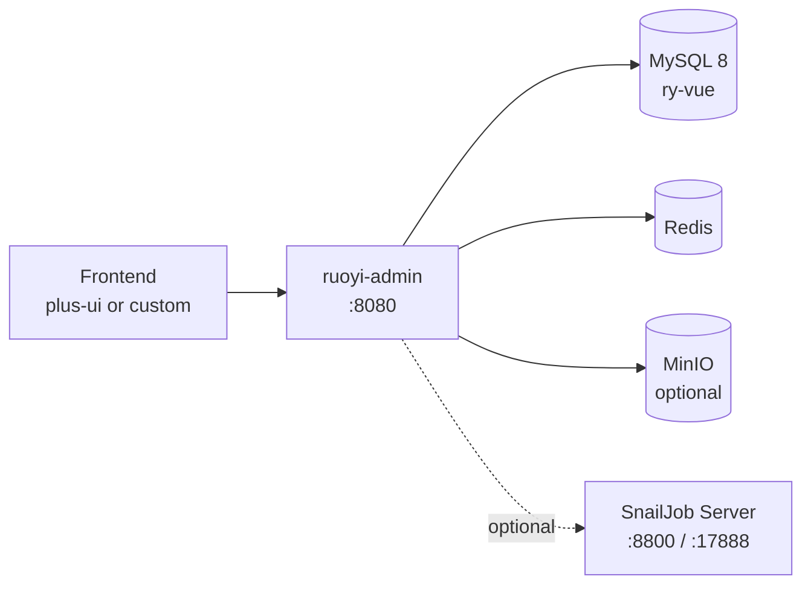

<div align="center">

# Spring Admin Lite

**A lean Spring Boot 4 admin starter based on RuoYi-Vue-Plus.**

<p>
  
  
  
  
  
  
  
</p>

<p>
  <a href="#-快速开始">快速开始</a> ·
  <a href="#-功能特性">功能特性</a> ·
  <a href="#-技术栈">技术栈</a> ·
  <a href="#-项目结构">项目结构</a> ·
  <a href="#-精简说明">精简说明</a> ·
  <a href="#-配置说明">配置说明</a> ·
  <a href="#-license">License</a>
</p>

</div>

---

## 📖 简介

Spring Admin Lite 是一个从 [RuoYi-Vue-Plus](https://gitee.com/dromara/RuoYi-Vue-Plus) 精简而来的后台管理 **后端** 启动模板。

它保留了后台系统最常用的基础能力：登录认证、RBAC 权限、用户/角色/菜单/部门/岗位、字典与参数、文件上传、消息推送、登录与操作日志，以及 Redis、MyBatis-Plus、Sa-Token 等基础设施。

同时移除了 AI、社交登录、通知公告、代码生成、演示模块、工作流、监控中心、MQTT、Elasticsearch、MCP 等非必要模块，让项目依赖更少、启动更快、表结构更清晰，适合作为新项目的起点。

> 本仓库只包含后端服务。前端可以搭配 RuoYi-Vue-Plus 配套的 `plus-ui`，或者根据接口自行开发。

## ✨ 功能特性

| 模块 | 能力 |
| :--- | :--- |
| 🔐 认证 | 密码、短信、邮箱、微信小程序认证策略，Sa-Token 会话管理 |
| 👥 权限 | 用户、部门、角色、菜单、岗位、数据权限 |
| ⚙️ 系统 | 参数配置、字典管理、客户端管理 |
| 📁 文件 | OSS 对象存储，内置 MinIO、七牛、阿里云、腾讯云配置 |
| 💬 消息 | 站内消息、SSE 推送、消息盒子 |
| 📝 审计 | 登录日志、操作日志 |
| 🧰 基础设施 | MySQL、Redis、MyBatis-Plus、Redisson、分布式锁、Excel、翻译、脱敏、字段加密 |
| ⏱️ 可选调度 | SnailJob 分布式任务调度，默认关闭 |

## 🧱 技术栈

| 分类 | 技术 | 版本 |
| :--- | :--- | :--- |
| 语言 | Java | 21 |
| 框架 | Spring Boot | 4.1.1 |
| 认证 | Sa-Token | 1.46.0 |
| ORM | MyBatis-Plus | 3.5.17 |
| 数据库 | MySQL | 8.0+ |
| 缓存 | Redis | 7+ |
| 文件存储 | MinIO / 七牛 / 阿里云 / 腾讯云 | 可选 |
| 接口文档 | SpringDoc OpenAPI | 3.1.1 |
| 构建 | Maven | 3.9+ |
| 任务调度 | SnailJob | 2.0.2（可选） |

## 🏗️ 架构



## 📦 项目结构

```text
spring-admin-lite/
├── ruoyi-admin/                 # Web 启动模块，AdminApplication
├── ruoyi-api/                   # API DTO 与服务接口
├── ruoyi-common/                # 通用能力
│   ├── ruoyi-common-core        # 核心工具与常量
│   ├── ruoyi-common-web         # Web 基础配置
│   ├── ruoyi-common-security    # 安全与权限
│   ├── ruoyi-common-satoken     # Sa-Token 集成
│   ├── ruoyi-common-mybatis     # MyBatis-Plus 集成
│   ├── ruoyi-common-redis       # Redis / Redisson
│   ├── ruoyi-common-oss         # 对象存储
│   ├── ruoyi-common-push        # 消息推送
│   ├── ruoyi-common-log         # 日志
│   ├── ruoyi-common-excel       # Excel
│   ├── ruoyi-common-mail        # 邮件
│   ├── ruoyi-common-sms         # 短信
│   ├── ruoyi-common-json        # JSON
│   ├── ruoyi-common-translation # 翻译
│   ├── ruoyi-common-sensitive   # 脱敏
│   ├── ruoyi-common-encrypt     # 加密
│   ├── ruoyi-common-doc         # 接口文档
│   └── ruoyi-common-bom         # 依赖版本管理
├── ruoyi-modules/
│   ├── ruoyi-system             # 系统业务：用户、角色、菜单、字典、OSS、消息等
│   └── ruoyi-job                # SnailJob 示例任务（可选）
├── ruoyi-extend/
│   └── ruoyi-snailjob-server    # SnailJob 服务端（可选）
└── script/
    ├── sql/                     # MySQL 初始化脚本
    └── docker/                  # Docker Compose、Nginx、Redis 配置
```

## 🧹 精简说明

相对于上游 RuoYi-Vue-Plus，本项目移除了以下模块和功能：

| 功能 | 状态 | 说明 |
| :--- | :---: | :--- |
| AI / Snail AI | ❌ 已移除 | 不再包含 AI 服务端、AI 公共模块和 AI 业务模块 |
| 社交登录 | ❌ 已移除 | 不包含 `ruoyi-common-social`、`sys_social` 和第三方绑定 |
| 通知公告 | ❌ 已移除 | 不包含 `sys_notice` 和相关菜单 |
| 代码生成 | ❌ 已移除 | 不包含 `ruoyi-gen` 和 `gen_table` |
| 演示模块 | ❌ 已移除 | 不包含 `ruoyi-demo`、`test_demo`、`test_tree` |
| 工作流 | ❌ 已移除 | 不包含 Warm-Flow、LiteFlow 和 `flow_*` 表 |
| 监控中心 | ❌ 已移除 | 不包含 Spring Boot Admin 服务端和客户端 |
| MQTT / ES / MCP | ❌ 已移除 | 不包含对应模块和配置 |
| SnailJob | ⚪ 可选 | 代码保留，默认 `snail-job.enabled: false` |
| 文件上传 | ✅ 保留 | 需要对象存储，默认配置为 MinIO |
| 消息推送 | ✅ 保留 | SSE / WebSocket 消息与消息盒子 |
| 审计日志 | ✅ 保留 | 登录日志与操作日志 |

MySQL 基础表由最初的 24 张精简到 **18 张**。工作流和 AI 的 SQL 已删除；SnailJob 的 23 张表在 `script/sql/ry_job.sql` 中，按需导入。

## 🚀 快速开始

### 环境要求

- JDK 21
- Maven 3.9+
- MySQL 8.0+
- Redis 7+
- MinIO（可选，文件上传功能需要）

### 1. 克隆项目

```bash
git clone https://github.com/xiaosongxiaosong1111/spring-admin-lite.git
cd spring-admin-lite
```

### 2. 初始化数据库

先创建 `ry-vue` 数据库，再导入基础表：

```bash
# Linux / macOS / Git Bash
mysql -uroot -proot -e "CREATE DATABASE IF NOT EXISTS \`ry-vue\` DEFAULT CHARACTER SET utf8mb4 COLLATE utf8mb4_general_ci;"
mysql -uroot -proot --default-character-set=utf8mb4 ry-vue < script/sql/ry_vue.sql
```

Windows PowerShell 不支持 `<` 重定向，可以用 `cmd /c`：

```bat
mysql -uroot -proot -e 'CREATE DATABASE IF NOT EXISTS `ry-vue` DEFAULT CHARACTER SET utf8mb4 COLLATE utf8mb4_general_ci;'
cmd /c "mysql -uroot -proot --default-character-set=utf8mb4 ry-vue < script\sql\ry_vue.sql"
```

### 3. 启动 Redis

默认连接 `localhost:6379`，密码 `ruoyi123`。可以用 Docker 快速启动：

```bash
docker run -d --name admin-lite-redis -p 6379:6379 redis:8.6.3 redis-server --requirepass ruoyi123
```

如果使用本地 Redis，请确保密码与 `application-dev.yml` 中的 `spring.data.redis.password` 一致。

### 4. 启动 MinIO（可选）

文件上传默认使用 MinIO，地址 `127.0.0.1:9000`，账号 `ruoyi / ruoyi123`，桶名 `ruoyi`。可以用 `script/docker/docker-compose.yml` 中的 `minio` 服务启动，或者使用你自己的对象存储。

不启动 MinIO 不影响应用启动，只影响文件上传。你也可以在「文件配置管理」中改成其他存储服务。

### 5. 修改配置

默认配置在 `ruoyi-admin/src/main/resources/application-dev.yml`：

| 配置 | 默认值 |
| :--- | :--- |
| MySQL | `localhost:3306/ry-vue`，`root / root` |
| Redis | `localhost:6379`，密码 `ruoyi123` |
| HTTP 端口 | `8080` |
| 默认环境 | `dev` |

### 6. 构建并启动

```bash
mvn clean package -DskipTests
java -jar ruoyi-admin/target/ruoyi-admin.jar
```

或者在 IDE 中直接运行 `ruoyi-admin` 模块下的 `org.dromara.AdminApplication`，并确保激活 `dev` Maven profile。

> `spring.profiles.active` 由 Maven 资源过滤生成。如果 IDE 直接运行出现 `@profiles.active@` 未被替换，请先执行一次 Maven 构建，或使用 `mvn -Pdev clean package`。

### 7. 登录

浏览器访问 `http://localhost:8080`，默认账号：

```text
用户名：admin
密码：admin123
```

## ⚙️ 配置说明

| 配置项 | 位置 | 说明 |
| :--- | :--- | :--- |
| 数据源 | `application-dev.yml` | MySQL 连接、账号密码 |
| Redis | `application-dev.yml` | 地址、端口、密码 |
| 文件存储 | 数据库 `sys_oss_config` | 默认 MinIO，可在“文件配置管理”中修改 |
| 消息推送 | `application.yml` | 默认 SSE，可切换 WebSocket |
| SnailJob | `application-dev.yml` | 默认 `enabled: false` |
| 接口文档 | `application.yml` | SpringDoc OpenAPI 配置 |

## 🗄️ 数据库

`script/sql/ry_vue.sql` 包含 18 张核心表：

<details>
<summary>展开查看表清单</summary>

- 用户权限：`sys_user`、`sys_dept`、`sys_post`、`sys_role`、`sys_menu`、`sys_user_role`、`sys_role_menu`、`sys_role_dept`、`sys_user_post`
- 配置字典：`sys_config`、`sys_dict_type`、`sys_dict_data`
- 日志：`sys_login_info`、`sys_oper_log`
- 其他：`sys_client`、`sys_message`、`sys_oss`、`sys_oss_config`

</details>

`script/sql/ry_job.sql` 包含 23 张 SnailJob 调度表，仅在启用 SnailJob 时需要导入。

## 🔌 可选功能

### SnailJob 分布式调度

默认关闭。需要时按以下步骤启用：

1. 导入 `script/sql/ry_job.sql`。
2. 启动 `ruoyi-extend/ruoyi-snailjob-server`。
3. 在 `application-dev.yml` 中将 `snail-job.enabled` 改为 `true`，并配置 `host`、`port`、`group`、`token`、`namespace`。
4. 在 SnailJob 控制台创建对应分组和命名空间。

如果不需要定时任务，可以保持关闭，也不需要导入 `ry_job.sql`。

### 文件上传

默认使用 MinIO。启动 MinIO 后，在控制台创建桶 `ruoyi`，或在「文件配置管理」中修改为七牛、阿里云、腾讯云等存储。

### 短信 / 邮件

短信使用 sms4j，配置在 `application-dev.yml` 的 `sms` 节点；邮件配置在 `mail` 节点。未配置时只影响验证码发送，不影响账号密码登录。

## 🐳 Docker 部署

`script/docker/docker-compose.yml` 提供了 MySQL、Redis、MinIO、Nginx、应用服务和 SnailJob 的部署参考。

注意：

- Compose 使用 Linux `host` 网络模式和 `/docker/...` 挂载路径，使用前请按你的环境修改。
- 应用镜像需要先自行构建，或改成你自己的镜像地址。
- 本地开发通常只需要启动 MySQL、Redis 和可选的 MinIO。

## 📝 设计说明

- **后端优先**：仓库只包含后端，前端可独立演进。
- **MySQL 优先**：模板以 MySQL 8 为默认数据库，其他数据库脚本暂未同步精简。
- **保留 `ruoyi-*` 命名**：为了便于和上游同步，模块和 artifactId 仍保留 `ruoyi-*` 前缀；如果要做完全独立的项目，可以统一替换。
- **默认安全**：Sa-Token 负责认证与会话，敏感字段支持脱敏和加密，接口支持加密传输。

## 🤝 贡献

欢迎提交 Issue 或 Pull Request。

- 提交前请确保 `mvn clean package -DskipTests` 可以通过。
- 新增功能请尽量保持模块边界清晰，避免把可选依赖带入核心模块。
- 如果删除或替换了上游功能，请在 README 中同步说明。

## 📄 License

本项目基于 [RuoYi-Vue-Plus](https://gitee.com/dromara/RuoYi-Vue-Plus) 精简，遵循 [MIT License](LICENSE)。

请保留原始版权声明，并在衍生项目中注明来源。

## 🙏 致谢

- [RuoYi-Vue-Plus](https://gitee.com/dromara/RuoYi-Vue-Plus)
- [Sa-Token](https://sa-token.cc/)
- [MyBatis-Plus](https://baomidou.com/)
- [Spring Boot](https://spring.io/projects/spring-boot)
- [SnailJob](https://snailjob.opensnail.com/)
- [MinIO](https://min.io/)

---

<div align="center">

### ⭐ 如果这个项目对你有帮助，欢迎点一个 Star

[](https://star-history.com/#xiaosongxiaosong1111/spring-admin-lite&Date)

</div>

---

## English

**Spring Admin Lite** is a lean Spring Boot 4 admin backend starter derived from [RuoYi-Vue-Plus](https://gitee.com/dromara/RuoYi-Vue-Plus).

It keeps the essentials: Sa-Token authentication, RBAC, user/role/menu/dept/post management, dictionaries and configuration, OSS file upload, SSE message push, audit logs, MySQL, Redis and MyBatis-Plus.

Removed: AI, social login, notices, code generation, demo, workflow, Spring Boot Admin, MQTT, Elasticsearch and MCP. SnailJob is optional and disabled by default.

Quick start:

```bash
mysql -uroot -proot -e "CREATE DATABASE IF NOT EXISTS \`ry-vue\` DEFAULT CHARACTER SET utf8mb4;"
mysql -uroot -proot ry-vue < script/sql/ry_vue.sql
mvn clean package -DskipTests
java -jar ruoyi-admin/target/ruoyi-admin.jar
```

Default account: `admin / admin123`.
